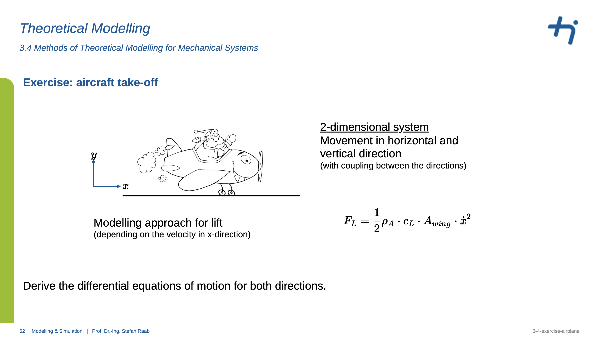

# 2D Aircraft Take-Off Dynamics & Simulation

**Author:** Ankit Thakur  
**Environment:** MATLAB / Simulink  

---

## Overview

This project models and simulates the 2D dynamics of an aircraft during take-off (horizontal ground roll and vertical lift-off). The model converts coupled differential equations derived from dynamic force equilibrium in both the $x$ (horizontal) and $y$ (vertical) directions into an interactive Simulink simulation.

The model explicitly accounts for aerodynamic drag, velocity-dependent lift generation, rolling ground friction, engine thrust, and non-linear normal force constraints ($F_N \ge 0$) to prevent unphysical downward wheel forces after rotation and lift-off.

---

## Theoretical Modeling Question 




---

## Mathematical Foundations

### 1. Horizontal Direction ($x$-Axis) Force Equilibrium
$$\sum F_x = 0 \Rightarrow F_{Prop} - F_{in,x} - F_{AR,x} - F_F = 0$$

$$\ddot{x} = \frac{1}{m} \left\{ F_{Prop} - \frac{1}{2}\rho_A \cdot c_{d,x} \cdot A_x \cdot \dot{x}^2 \cdot \text{sign}(\dot{x}) - \mu \cdot \max\left[ \left( m \cdot g - \frac{1}{2}\rho_A \cdot c_L \cdot A_x \cdot \dot{x}^2 \right), 0 \right] \cdot \text{sign}(\dot{x}) \right\}$$

### 2. Vertical Direction ($y$-Axis) Force Equilibrium
$$\sum F_y = 0 \Rightarrow F_N + F_L - F_G - F_{in,y} - F_{AR,y} = 0$$

$$\ddot{y} = \frac{1}{m} \left\{ \max\left[ \left( m \cdot g - \frac{1}{2} \rho_A \cdot c_L \cdot A_x \cdot \dot{x}^2 \right), 0 \right] + \frac{1}{2} \rho_A \cdot c_L \cdot A_x \cdot \dot{x}^2 - \frac{1}{2} \rho_A \cdot c_{d,y} \cdot A_y \cdot \dot{y}^2 \cdot \text{sign}(\dot{y}) \right\} - g$$

---

## Model Preview 


>*Note: I will put Model Preview


---


---

## Simulation Parameters

The parameters defined in `src/aircraft_parameter.m` are:

>*Note: I will make a table here with aircraft_parameters

---

## Repository File Structure

```text
AirplanModel_X-Y_Direction/
├── .gitignore                      # Excludes temporary Simulink cache and build files
├── README.md                       # Repository documentation and mathematical overview
├── src/
│   ├── aircraft_parameter.m        # MATLAB m-file containing system physical parameters
│   └── aircraftModel.slx           # Simulink block diagram implementing the 2D differential equations
├── data/
│   └── Validation_airplane_x.mat   # Validation flight dataset for model verification
└── doc/
    ├── handwritten_equations.pdf   # Step-by-step hand-derived differential equations
    └── images/                     # System diagrams and simulation preview graphics
        └── model_preview.png       # Image preview displayed in README